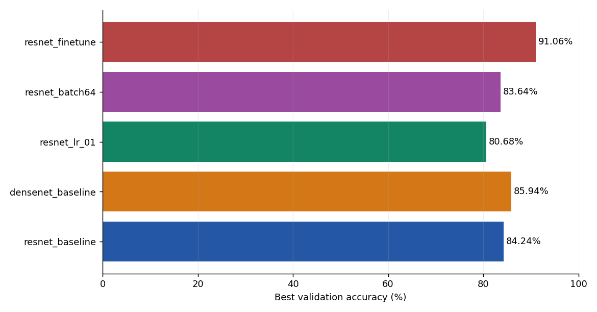
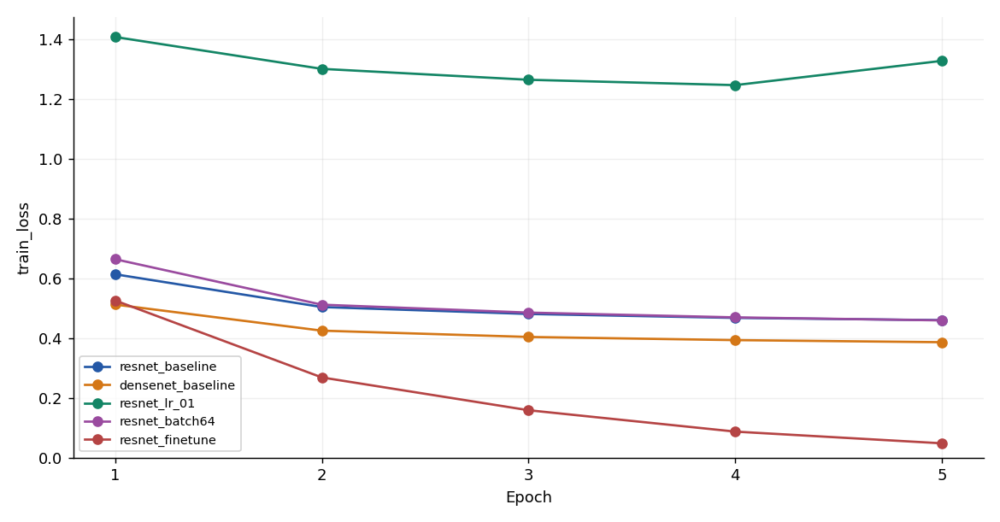
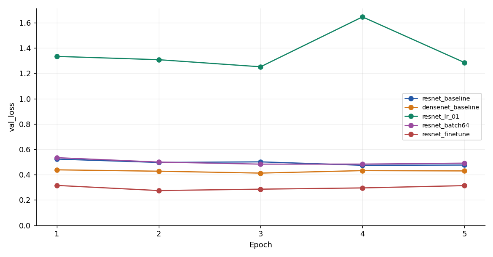
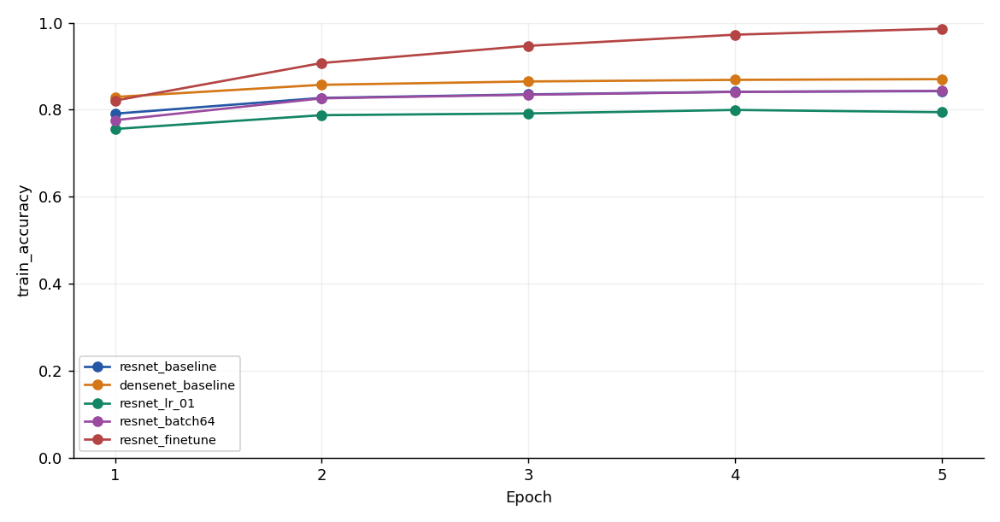
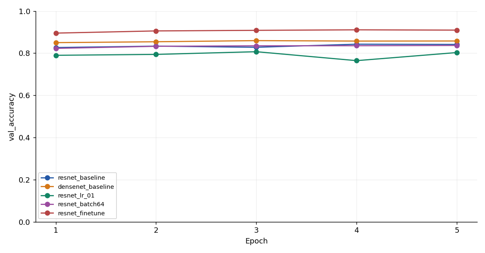
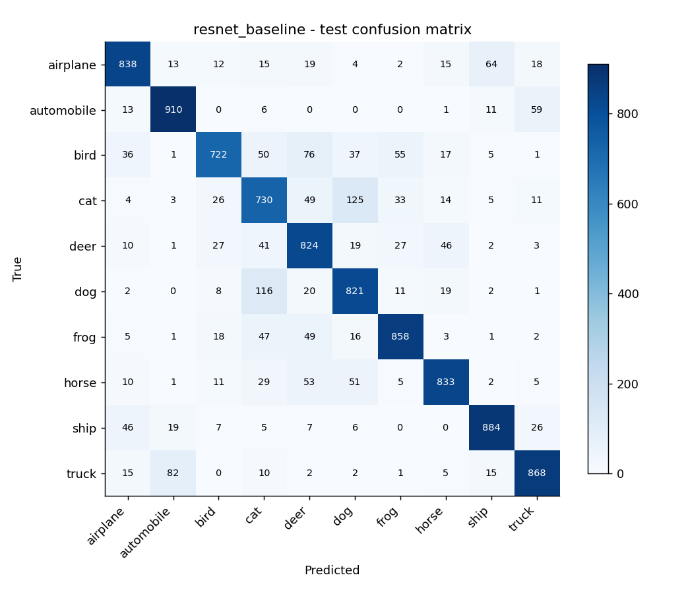
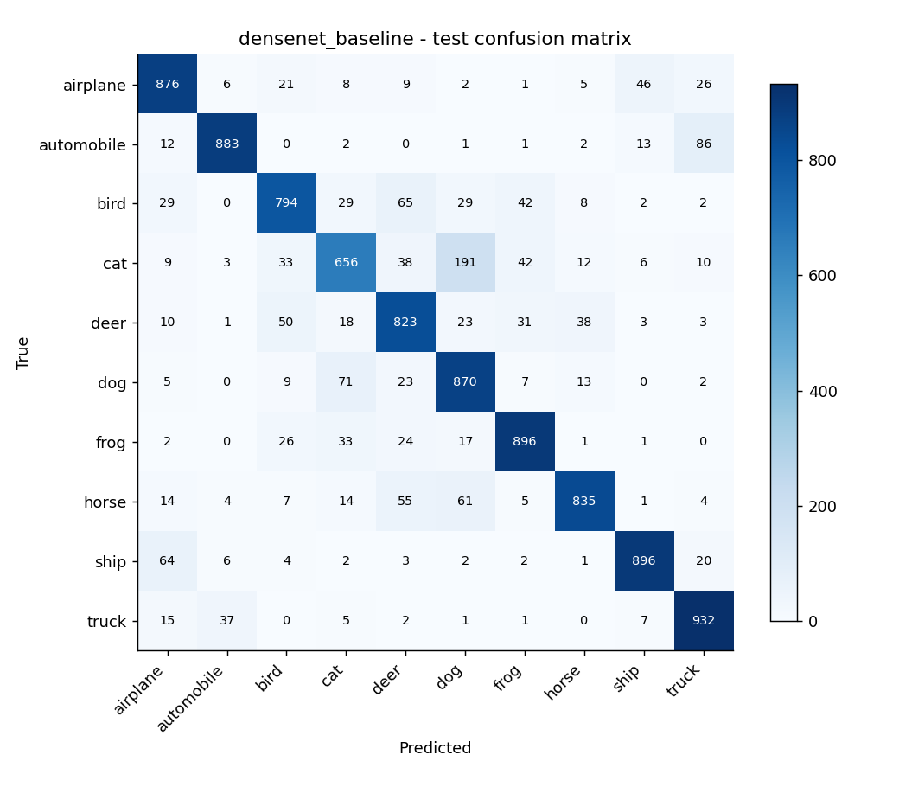

# Đánh giá mô hình

## Kết quả

| Run | LR | Batch | Best epoch | Val acc (%) | Test acc (%) |
| --- | --- | --- | --- | --- | --- |
| resnet_baseline | 0.001 | 32 | 4 | 84.24 | 82.88 |
| densenet_baseline | 0.001 | 32 | 3 | 85.94 | 84.61 |
| resnet_lr_01 | 0.01 | 32 | 3 | 80.68 |  |
| resnet_batch64 | 0.001 | 64 | 5 | 83.64 |  |
| resnet_finetune | 0.001 | 32 | 4 | 91.06 | 90.05 |

| Run | Optimization (s) | Feature extraction dùng chung (s) |
|---|---:|---:|
| resnet_baseline | 3.52 | 133.52 |
| densenet_baseline | 3.79 | 374.73 |
| resnet_lr_01 | 3.87 | 133.52 |
| resnet_batch64 | 2.7 | 133.52 |
| resnet_finetune | 849.21 | 0.0 |

Các ô test trống là cấu hình không được đánh giá test theo kế hoạch, không phải accuracy bằng 0. Sau khi kết thúc toàn bộ lượt validation, khóa lựa chọn trong selection_before_test.json. Test hai kiến trúc baseline và cấu hình thắng validation (nếu khác baseline) trên đủ 10.000 ảnh, không điều chỉnh lại hyperparameter sau khi xem test.

Thời gian optimization của lượt head KHÔNG gồm trích xuất đặc trưng; cột feature extraction là chi phí dùng chung theo kiến trúc. Không dùng riêng optimization seconds để tuyên bố model này nhanh hơn model khác. Cùng chi phí extraction được ghi lại ở các lượt ResNet head và không cộng lặp khi tính ngân sách toàn bộ.

## Phân tích

- So sánh kiến trúc: DenseNet121 đạt validation 85.94%, so với ResNet18 84.24%, chênh lệch +1.70 điểm phần trăm trong điều kiện này. Chênh lệch có thể do kiến trúc và đặc trưng pretrained, không đủ để kết luận một kiến trúc luôn tốt hơn.

- Learning rate: 0.01 đạt 80.68%, thay đổi -3.56 điểm phần trăm so với 0.001. LR điều khiển độ lớn bước cập nhật; đánh giá cùng đường loss để xem hội tụ/dao động, không chỉ accuracy cuối.

- Batch size: 64 đạt 83.64%, thay đổi -0.60 điểm phần trăm so với 32. Với 45.000 ảnh, batch 32 có 1.407 bước/epoch, batch 64 có 704 bước; ngân sách ảnh/epoch bằng nhau nhưng số optimizer steps khác nhau. Đây là giới hạn quan trọng khi diễn giải.

- Fine-tuning: layer4+fc đạt 91.06%, thay đổi +6.82 điểm phần trăm so với chỉ học head. Mở thêm lớp tăng khả năng thích nghi và chi phí tính toán; có thể tăng nguy cơ overfitting. Không chọn thêm LR sau khi xem test.

- Cấu hình được chọn bằng validation: resnet_finetune, epoch 4, validation 91.06%.

Ở lượt LR=0.01, từ epoch 3 sang 4, validation loss 1.2520 → 1.6461, accuracy 80.68% → 76.44%. Dao động này cùng mức best thấp hơn baseline cho thấy LR=0.01 chưa phù hợp trong cấu hình đang xét. Không thể suy ra mọi LR lớn đều kém từ một thử nghiệm.

DenseNet đạt best ở epoch 3. Từ đó đến epoch cuối, train loss 0.4035 → 0.3860, trong khi validation loss 0.4123 → 0.4295. Mẫu này gợi ý lợi ích tổng quát hóa đã chững lại; lưu best validation checkpoint giúp tránh mặc định dùng epoch cuối.

Ở fine-tuning, validation loss thấp nhất tại epoch 2 (0.2744), còn validation accuracy cao nhất tại epoch 4. Hai thước đo có thể khác nhau: accuracy chỉ xét nhãn argmax, CrossEntropy còn xét xác suất gán cho nhãn đúng. Vì vậy loss có thể tăng khi một số dự đoán sai trở nên quá tự tin dù số dự đoán đúng tăng. Bài giữ tiêu chí accuracy đã chọn từ đầu, đồng thời ghi nhận rủi ro overfitting; không đổi tiêu chí sau khi thấy test.

- resnet_baseline: train loss 0.6132 → 0.4597; val loss 0.5230 → 0.4760; khoảng cách train−val accuracy cuối +0.11 điểm %.

- densenet_baseline: train loss 0.5119 → 0.3860; val loss 0.4382 → 0.4295; khoảng cách train−val accuracy cuối +1.25 điểm %.

- resnet_lr_01: train loss 1.4068 → 1.3270; val loss 1.3342 → 1.2859; khoảng cách train−val accuracy cuối -0.86 điểm %.

- resnet_batch64: train loss 0.6636 → 0.4590; val loss 0.5341 → 0.4908; khoảng cách train−val accuracy cuối +0.68 điểm %.

- resnet_finetune: train loss 0.5256 → 0.0478; val loss 0.3151 → 0.3134; khoảng cách train−val accuracy cuối +7.69 điểm %.

Train accuracy được đo ngay trong vòng lặp cập nhật trọng số; validation được đo sau epoch. Vì vậy train có thể thấp hơn validation. Với fine-tuning còn có khác biệt chế độ BatchNorm train/eval ở layer4. Các khoảng cách trên mô tả đường học, không tự động chứng minh hoặc loại trừ overfitting chỉ từ một epoch.

Cấu hình được chọn đạt test accuracy **90.05%**, macro F1 **0.9008**. Chênh validation−test +1.01 điểm %.

Cặp nhầm có số lượng lớn nhất theo một chiều trong test: ảnh thật dog bị dự đoán cat (117 ảnh). Đây là quan sát từ confusion matrix; cần xem ảnh cụ thể trước khi quy nguyên nhân.

### Precision / Recall / F1 của cấu hình được chọn

| Lớp | Precision | Recall | F1 | Số ảnh |
|---|---:|---:|---:|---:|
| airplane | 0.9232 | 0.9140 | 0.9186 | 1000 |
| automobile | 0.9440 | 0.9440 | 0.9440 | 1000 |
| bird | 0.9154 | 0.8660 | 0.8900 | 1000 |
| cat | 0.7809 | 0.8270 | 0.8033 | 1000 |
| deer | 0.8926 | 0.8730 | 0.8827 | 1000 |
| dog | 0.8236 | 0.8450 | 0.8342 | 1000 |
| frog | 0.9291 | 0.9430 | 0.9360 | 1000 |
| horse | 0.9353 | 0.9100 | 0.9225 | 1000 |
| ship | 0.9217 | 0.9530 | 0.9371 | 1000 |
| truck | 0.9499 | 0.9300 | 0.9399 | 1000 |

## Đồ thị

Các PNG được vẽ từ history.csv chưa smoothing. Bằng chứng dùng TensorBoard là event files trong results/[run]/tensorboard; mở bằng `python -m tensorboard.main --logdir results`. Cả bốn scalar được ghi theo epoch, có thể so sánh nhiều run. PNG không thay thế event logs.

## Hạn chế

Một seed và 5 epoch chưa đủ đánh giá độ ổn định thống kê. Resize 96 không phải recipe ImageNet chuẩn 224; kết quả chỉ áp dụng cho pipeline này. Không augmentation hoặc lịch LR để giữ so sánh đơn giản, nên đây không phải kết quả tối ưu CIFAR-10. Việc chọn trong nhiều cấu hình có thể làm validation lạc quan; giữ test làm đánh giá cuối. Hướng phát triển: chạy thêm seed, augmentation và LR schedule với kế hoạch chọn bằng validation trước khi dùng test mới.

## Bằng chứng

[comparison.csv](../results/comparison.csv), [selection_before_test.json](../results/selection_before_test.json), [verification.json](../results/verification.json). Mỗi mô hình đã test có `test_metrics.json` và `test_predictions.csv`. Hồ sơ kiểm tra cũ: [VALIDATION.md](../report/VALIDATION.md).
