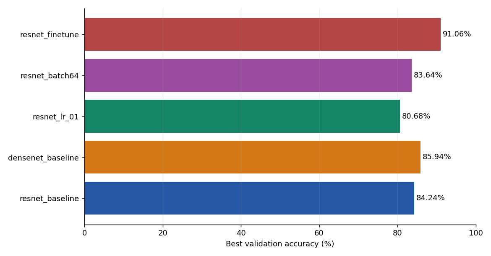
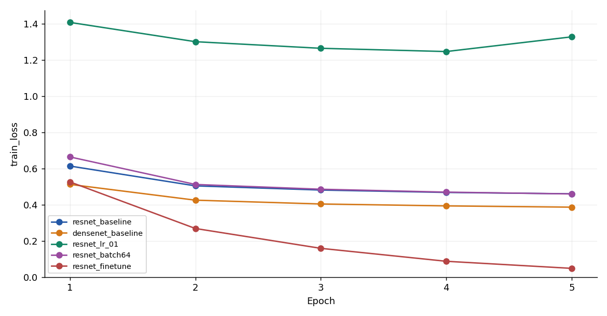
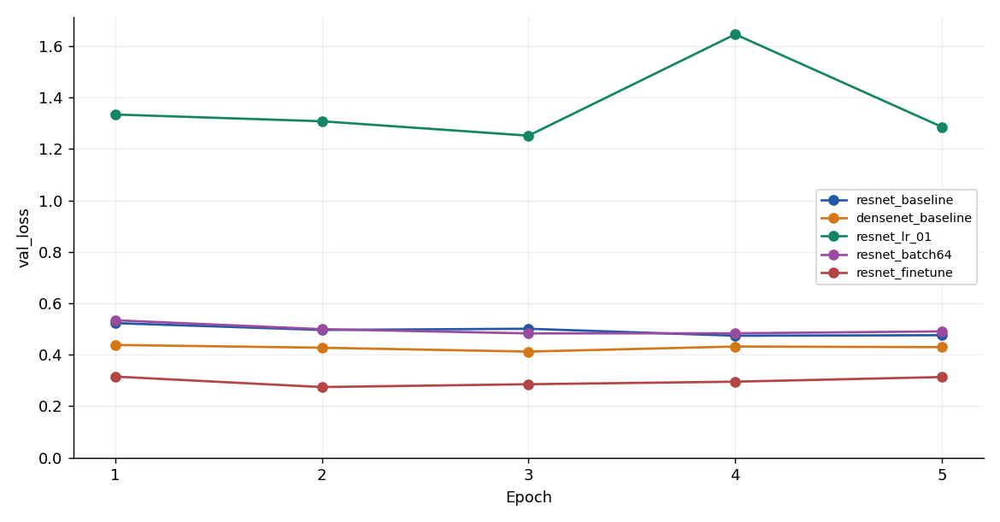
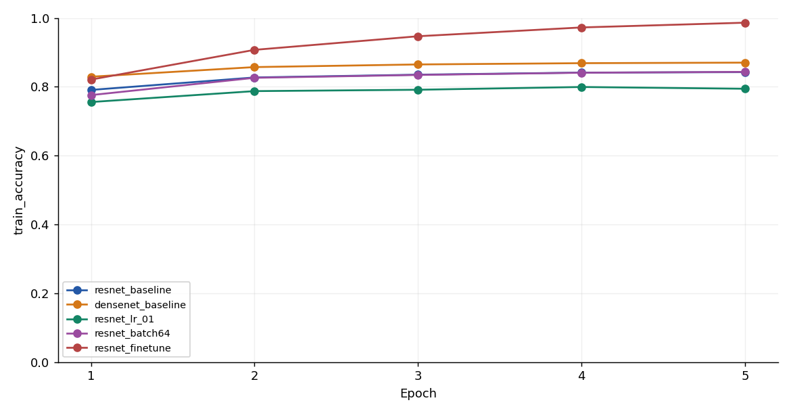
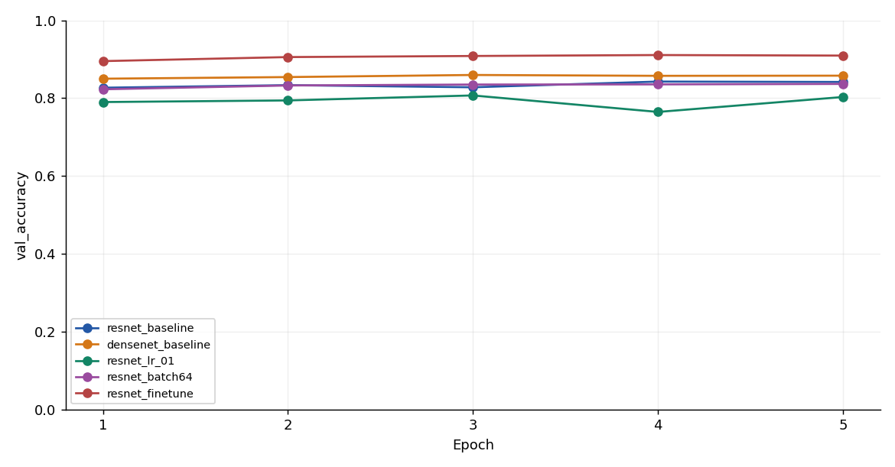
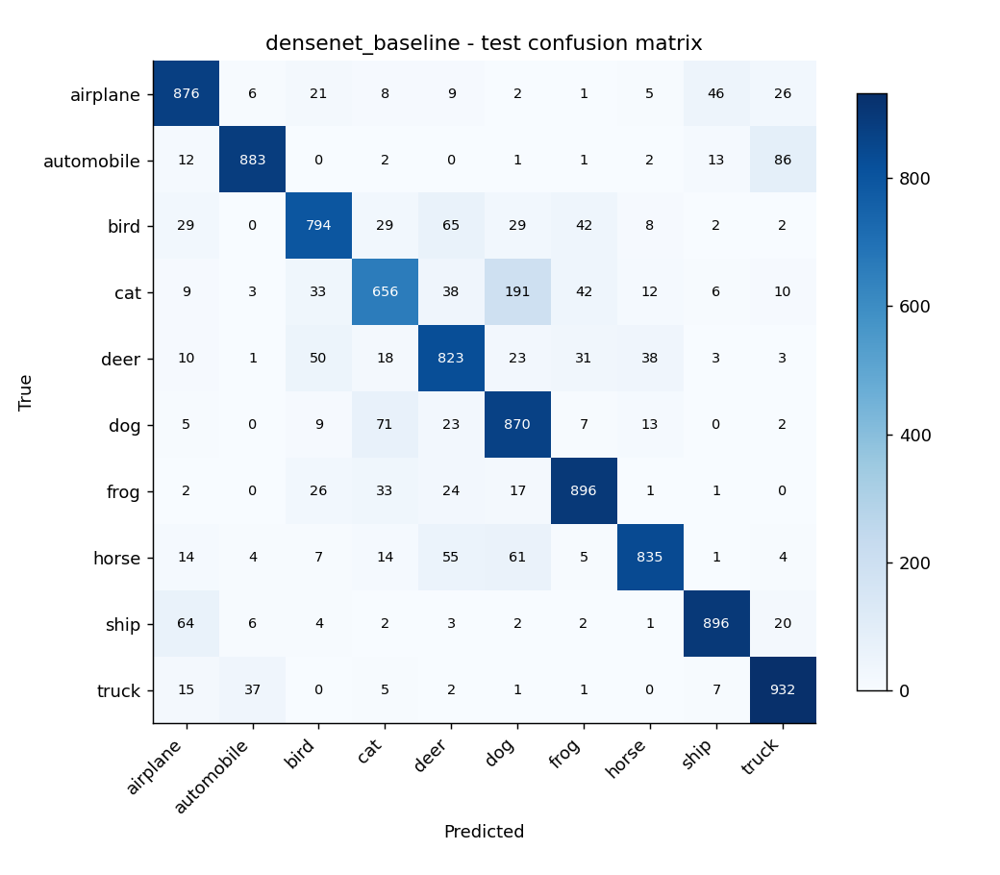
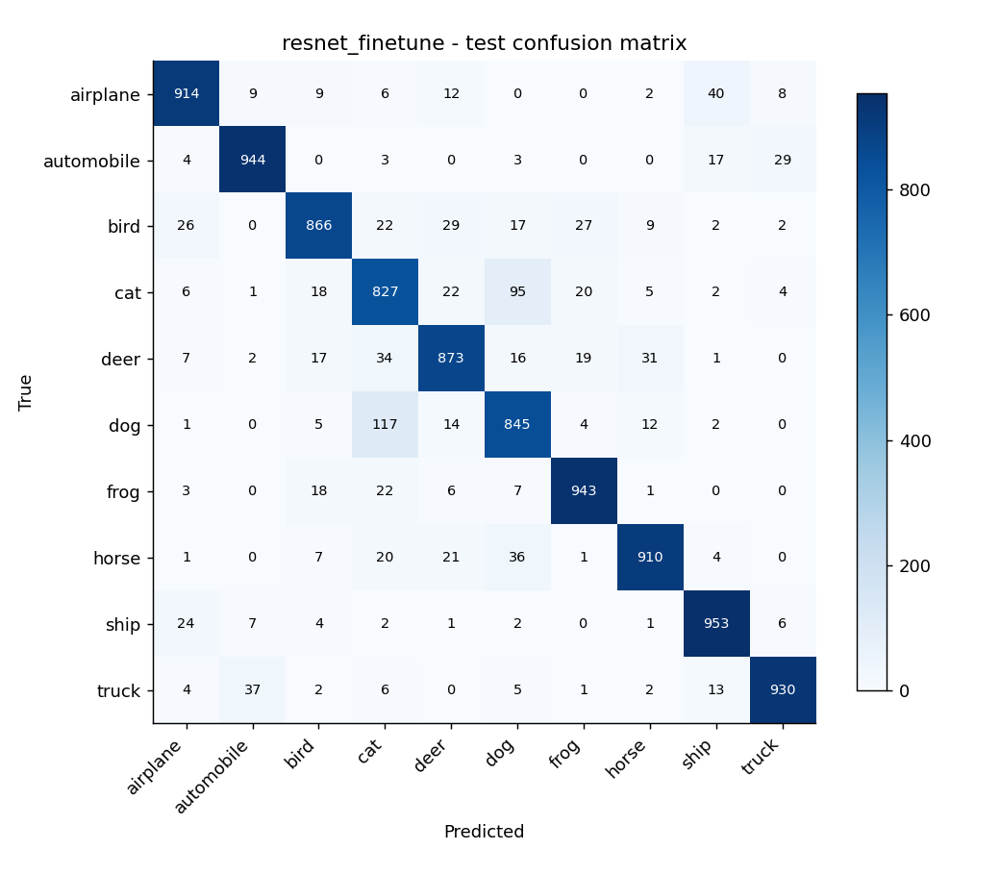

# PRACTICE 2 - HUẤN LUYỆN VÀ THÍCH NGHI MẠNG PRETRAINED

Thông tin nhóm: [Điền họ tên và MSSV của ba thành viên] · Lớp: [Điền] · Giảng viên: [Điền].

Bài thực nghiệm trên CIFAR-10. Các bảng được sinh từ log chạy thật; không dùng số liệu mô phỏng.

Tóm tắt: Thực hiện năm lượt huấn luyện trên đầy đủ CIFAR-10 với ResNet18 và DenseNet121 pretrained ImageNet, so sánh kiến trúc, learning rate, batch size và fine-tuning. Giữ cùng split, preprocessing 96×96, seed 42 và 5 epoch. Cấu hình được chọn bằng validation là resnet_finetune, đạt validation 91.06% và test 90.05% trên 10.000 ảnh.

## 1. Đối chiếu yêu cầu đề

| Yêu cầu slide 23 | Bằng chứng trong bài |
|---|---|
| Cài PyTorch/torchvision | requirements.txt, results/environment.json |
| Nạp pretrained | ResNet18 và DenseNet121, IMAGENET1K_V1 |
| Xem kiến trúc và tham số | results/[run]/architecture.txt, parameters.json; notebook in mô hình |
| Thay lớp cuối và freeze/fine-tune | fc/classifier 10 lớp; head hoặc layer4+fc |
| transforms và DataLoader | src/experiment.py: loaders_data, DataLoader ảnh và feature batches |
| Loss/optimizer/training loop | CrossEntropyLoss, SGD momentum 0.9, run_epoch |
| Đánh giá test | test_metrics.json, confusion matrix, classification report |
| Thử nhiều kiến trúc | resnet_baseline / densenet_baseline |
| Đổi hyperparameters | resnet_lr_01 / resnet_batch64 |
| TensorBoard | results/[run]/tensorboard, bốn scalar theo epoch |

## 2. Dữ liệu và thiết kế thực nghiệm

CIFAR-10 có 50.000 ảnh train gốc và 10.000 ảnh test, mỗi ảnh RGB 32×32, 10 lớp. Từ train gốc, tách phân tầng 45.000 train và 5.000 validation (500/lớp) với seed 42. Dùng đầy đủ dữ liệu, không dùng tập con. Chỉ số split lưu trong results/split.json. Test tách biệt hoàn toàn, không chọn cấu hình bằng test.

Ảnh được resize 96×96, ToTensor và normalize mean=(0.485,0.456,0.406), std=(0.229,0.224,0.225). Không augmentation. Kích thước 96 là lựa chọn thực nghiệm phù hợp CPU; đề không bắt buộc 224. Cùng preprocessing cho cả năm lượt. Không trộn kết quả với thí nghiệm cũ 224×224 trong repo nhóm.

Mỗi lượt 5 epoch, SGD momentum 0.9, weight_decay=0, CrossEntropyLoss trên logits (không thêm softmax trước loss). Các lượt khởi tạo từ pretrained ImageNet và cùng khởi tạo head theo seed 42; fine-tuning không lấy checkpoint baseline để tránh thêm ngân sách học. Chọn best checkpoint theo validation accuracy; nếu hòa giữ epoch xuất hiện đầu tiên.

## 3. Kiến trúc, transfer learning và fine-tuning

ResNet18 dùng residual connections. Thay fc 512→1000 bằng Linear(512,10); mode head chỉ học fc.weight/fc.bias, tổng 5,130 tham số trên 11,181,642 tham số mô hình. DenseNet121 nối đặc trưng qua dense connections; classifier mới Linear(1024,10), học 10,250/6,964,106 tham số.

Fine-tuning ResNet18 mở layer4 và fc, tổng 8,398,858 tham số. Các lớp trước frozen và eval; layer4 và fc ở train. Với mode head, toàn bộ backbone ở eval để không đổi BatchNorm running statistics.

Các lượt head dùng cache đặc trưng để tiết kiệm CPU. Backbone frozen, eval và preprocessing xác định nên cùng ảnh luôn có cùng feature; học head trên cache tương đương học head trên output backbone cố định, trong sai số tính toán. Đã kiểm tra forward cached và full model khớp. Không cache backbone cho fine-tuning vì trọng số thay đổi. Đây là tối ưu tính toán, không bổ sung dữ liệu hay thay đổi bài toán.

## 4. Kết quả validation và test

| Run | LR | Batch | Best epoch | Val acc (%) | Test acc (%) |
| --- | --- | --- | --- | --- | --- |
| resnet_baseline | 0.001 | 32 | 4 | 84.24 | 82.88 |
| densenet_baseline | 0.001 | 32 | 3 | 85.94 | 84.61 |
| resnet_lr_01 | 0.01 | 32 | 3 | 80.68 |  |
| resnet_batch64 | 0.001 | 64 | 5 | 83.64 |  |
| resnet_finetune | 0.001 | 32 | 4 | 91.06 | 90.05 |


| Run | Optimization (s) | Feature extraction dùng chung (s) |
|---|---:|---:|
| resnet_baseline | 3.52 | 133.52 |
| densenet_baseline | 3.79 | 374.73 |
| resnet_lr_01 | 3.87 | 133.52 |
| resnet_batch64 | 2.7 | 133.52 |
| resnet_finetune | 849.21 | 0.0 |


Các ô test trống là cấu hình không được đánh giá test theo kế hoạch, không phải accuracy bằng 0. Sau khi kết thúc toàn bộ lượt validation, khóa lựa chọn trong selection_before_test.json. Test hai kiến trúc baseline và cấu hình thắng validation (nếu khác baseline) trên đủ 10.000 ảnh, không điều chỉnh lại hyperparameter sau khi xem test.

Thời gian optimization của lượt head KHÔNG gồm trích xuất đặc trưng; cột feature extraction là chi phí dùng chung theo kiến trúc. Không dùng riêng optimization seconds để tuyên bố model này nhanh hơn model khác. Cùng chi phí extraction được ghi lại ở các lượt ResNet head và không cộng lặp khi tính ngân sách toàn bộ.

## 5. Phân tích kết quả

- So sánh kiến trúc: DenseNet121 đạt validation 85.94%, so với ResNet18 84.24%, chênh lệch +1.70 điểm phần trăm trong điều kiện này. Chênh lệch có thể do kiến trúc và đặc trưng pretrained, không đủ để kết luận một kiến trúc luôn tốt hơn.

- Learning rate: 0.01 đạt 80.68%, thay đổi -3.56 điểm phần trăm so với 0.001. LR điều khiển độ lớn bước cập nhật; đánh giá cùng đường loss để xem hội tụ/dao động, không chỉ accuracy cuối.

- Batch size: 64 đạt 83.64%, thay đổi -0.60 điểm phần trăm so với 32. Với 45.000 ảnh, batch 32 có 1.407 bước/epoch, batch 64 có 704 bước; ngân sách ảnh/epoch bằng nhau nhưng số optimizer steps khác nhau. Đây là giới hạn quan trọng khi diễn giải.

- Fine-tuning: layer4+fc đạt 91.06%, thay đổi +6.82 điểm phần trăm so với chỉ học head. Mở thêm lớp tăng khả năng thích nghi và chi phí tính toán; có thể tăng nguy cơ overfitting. Không chọn thêm LR sau khi xem test.

- Cấu hình được chọn bằng validation: resnet_finetune, epoch 4, validation 91.06%.

Ở lượt LR=0.01, từ epoch 3 sang 4, validation loss 1.2520 → 1.6461, accuracy 80.68% → 76.44%. Dao động này cùng mức best thấp hơn baseline cho thấy LR=0.01 chưa phù hợp trong cấu hình đang xét. Không thể suy ra mọi LR lớn đều kém từ một thử nghiệm.

DenseNet đạt best ở epoch 3. Từ đó đến epoch cuối, train loss 0.4035 → 0.3860, trong khi validation loss 0.4123 → 0.4295. Mẫu này gợi ý lợi ích tổng quát hóa đã chững lại; lưu best validation checkpoint giúp tránh mặc định dùng epoch cuối.

Ở fine-tuning, validation loss thấp nhất tại epoch 2 (0.2744), còn validation accuracy cao nhất tại epoch 4. Hai thước đo có thể khác nhau: accuracy chỉ xét nhãn argmax, CrossEntropy còn xét xác suất gán cho nhãn đúng. Vì vậy loss có thể tăng khi một số dự đoán sai trở nên quá tự tin dù số dự đoán đúng tăng. Bài giữ tiêu chí accuracy đã chọn từ đầu, đồng thời ghi nhận rủi ro overfitting; không đổi tiêu chí sau khi thấy test.

- resnet_baseline: train loss 0.6132 → 0.4597; val loss 0.5230 → 0.4760; khoảng cách train−val accuracy cuối +0.11 điểm %.

- densenet_baseline: train loss 0.5119 → 0.3860; val loss 0.4382 → 0.4295; khoảng cách train−val accuracy cuối +1.25 điểm %.

- resnet_lr_01: train loss 1.4068 → 1.3270; val loss 1.3342 → 1.2859; khoảng cách train−val accuracy cuối -0.86 điểm %.

- resnet_batch64: train loss 0.6636 → 0.4590; val loss 0.5341 → 0.4908; khoảng cách train−val accuracy cuối +0.68 điểm %.

- resnet_finetune: train loss 0.5256 → 0.0478; val loss 0.3151 → 0.3134; khoảng cách train−val accuracy cuối +7.69 điểm %.

Train accuracy được đo ngay trong vòng lặp cập nhật trọng số; validation được đo sau epoch. Vì vậy train có thể thấp hơn validation. Với fine-tuning còn có khác biệt chế độ BatchNorm train/eval ở layer4. Các khoảng cách trên mô tả đường học, không tự động chứng minh hoặc loại trừ overfitting chỉ từ một epoch.

Cấu hình được chọn đạt test accuracy **90.05%**, macro F1 **0.9008**. Chênh validation−test +1.01 điểm %.

Cặp nhầm có số lượng lớn nhất theo một chiều trong test: ảnh thật dog bị dự đoán cat (117 ảnh). Đây là quan sát từ confusion matrix; cần xem ảnh cụ thể trước khi quy nguyên nhân.

### Precision / Recall / F1 của cấu hình được chọn

| Lớp | Precision | Recall | F1 | Số ảnh |
|---|---:|---:|---:|---:|
| airplane | 0.9232 | 0.9140 | 0.9186 | 1000 |
| automobile | 0.9440 | 0.9440 | 0.9440 | 1000 |
| bird | 0.9154 | 0.8660 | 0.8900 | 1000 |
| cat | 0.7809 | 0.8270 | 0.8033 | 1000 |
| deer | 0.8926 | 0.8730 | 0.8827 | 1000 |
| dog | 0.8236 | 0.8450 | 0.8342 | 1000 |
| frog | 0.9291 | 0.9430 | 0.9360 | 1000 |
| horse | 0.9353 | 0.9100 | 0.9225 | 1000 |
| ship | 0.9217 | 0.9530 | 0.9371 | 1000 |
| truck | 0.9499 | 0.9300 | 0.9399 | 1000 |


## 6. Đồ thị và TensorBoard
















Các PNG được vẽ từ history.csv chưa smoothing. Bằng chứng dùng TensorBoard là event files trong results/[run]/tensorboard; mở bằng `python -m tensorboard.main --logdir results`. Cả bốn scalar được ghi theo epoch, có thể so sánh nhiều run. PNG không thay thế event logs.

## 7. Hạn chế và hướng phát triển

Một seed và 5 epoch chưa đủ đánh giá độ ổn định thống kê. Resize 96 không phải recipe ImageNet chuẩn 224; kết quả chỉ áp dụng cho pipeline này. Không augmentation hoặc lịch LR để giữ so sánh đơn giản, nên đây không phải kết quả tối ưu CIFAR-10. Việc chọn trong nhiều cấu hình có thể làm validation lạc quan; giữ test làm đánh giá cuối. Hướng phát triển: chạy thêm seed, augmentation và LR schedule với kế hoạch chọn bằng validation trước khi dùng test mới.

## 8. Cách chạy lại

Python >=3.11. Cài requirements. Từ thư mục gốc chạy `python -m src.download_data`, rồi `python -u -m src.experiment --image-size 96 --epochs 5`, sau đó `python -m src.make_report`. Chạy kiểm tra bằng `python -m unittest discover -s tests -v`. Có notebook Colab trọn bài và cách upload archive khi nguồn mạng chậm. Muốn chạy cấu hình khác phải dùng thư mục kết quả mới, không trộn log.

Môi trường thực tế:

```json
{
  "python": "3.12.14",
  "torch": "2.15.0+cpu",
  "torchvision": "0.29.2+cpu",
  "device": "cpu",
  "gpu": null,
  "cpu_threads": 4,
  "image_size": 96,
  "epochs": 5,
  "source_sha256": "57918eed8e84b355d019d4d723b3b21c1545ad234f2a591801bc36510dd6fc32"
}
```

## 9. Tài liệu tham khảo

- Đề lớp: Practice 2, Chapter 3, slide 23; ví dụ CIFAR-10 ở slide 24. PDF đề không đưa vào gói để công khai lại.
- Alex Krizhevsky (2009), Learning Multiple Layers of Features from Tiny Images; https://cave.cs.toronto.edu/kriz/cifar.html
- PyTorch, Transfer Learning for Computer Vision Tutorial; https://docs.pytorch.org/tutorials/beginner/transfer_learning_tutorial
- Torchvision, Models and pre-trained weights; https://docs.pytorch.org/vision/stable/models.html

## 10. Gợi ý trả lời khi trình bày

- Vì sao thay lớp cuối? ImageNet có 1.000 lớp, CIFAR-10 có 10 lớp.
- Vì sao freeze? Tận dụng feature đã học và giảm tham số cần cập nhật.
- Fine-tuning khác gì? Mở layer4 để feature thích nghi với dữ liệu đích.
- Vì sao không dùng test chọn LR? Sẽ làm rò rỉ thông tin đánh giá vào lựa chọn cấu hình.
- Vì sao val accuracy có thể cao hơn train? Train được đo trong lúc trọng số thay đổi, validation sau epoch; đây chưa phải bằng chứng sai dữ liệu.
- Vì sao thời gian head nhỏ? Đã tách chi phí trích xuất đặc trưng; phải tính cả chi phí đó khi so sánh.
- Vì sao không kết luận “luôn tốt hơn”? Một dataset, một seed và ngân sách nhỏ không đủ khái quát.